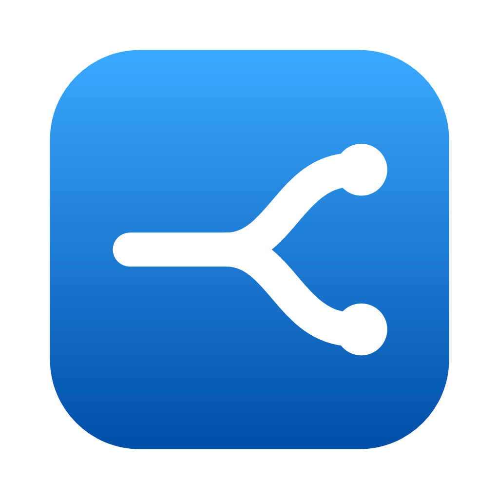

<p align="center">
  
</p>

<h1 align="center">Game Audio Splitter</h1>

<p align="center">
  Play one app's sound on extra speakers, headphones or capture devices at the same time,<br>
  without touching your main output and without using your CPU.
</p>

<p align="center">
  
  
  
</p>

---

## Overview

Game Audio Splitter copies the audio of **one app** (for example a game) or of **a whole output device**
to one or more additional outputs, live. Your main output (earphones, IEMs, USB DAC) keeps playing exactly
as before. The copy is made with the operating system's own audio APIs. There are no virtual drivers,
no kernel extensions and no background services.

| | Windows | macOS |
|---|---|---|
| Copy one app's audio | ✔ (process loopback) | ✔ (Core Audio process taps) |
| Copy a whole device / all system audio | ✔ | ✔ |
| Several outputs at once | ✔ | ✔ |
| Per-device volume, balance and mute (synced with the system) | ✔ | ✔ |
| "Follow main volume" per device | ✔ | ✔ |
| Per-app volume mixer | Built into Windows | ✔ **App volume** tab |
| Hot-plug (Bluetooth, USB) with automatic reconnect | ✔ | ✔ |

## Performance

Performance is the main design goal. Measured on the release builds:

| | Windows | macOS |
|---|---|---|
| CPU while copying | **0.02 %** of total CPU (16-core laptop) | not measured yet |
| CPU while idle | ~0 % | **0.0 %** (Apple Silicon) |
| Audio path | Bit-exact copy, no resampling unless the devices' rates differ | Plain copy at unity gain |
| Memory, minimised | ~8 MB | — |
| Stop / release devices | ~30 ms | — |

* The audio thread sleeps until the system delivers audio. There is no polling and no busy loop.
* Volume and balance are applied by the system mixer of each device, not by the app.
* Device changes arrive as system notifications. The UI does no work while minimised or hidden.

## Installation

The repository is private: cloning needs access to it (for example `gh auth login`).

### Windows (command line)

Requirements: Windows 10 (2004+) or Windows 11, 64-bit. Nothing else: the C# compiler and WPF ship with Windows.

```powershell
git clone https://github.com/Rsng-Phoenix/game-audio-splitter.git
cd game-audio-splitter
powershell -ExecutionPolicy Bypass -File windows\install.ps1
```

This builds the app, installs it to `%LOCALAPPDATA%\Programs\GameAudioSplitter` (no admin rights needed)
and adds **Game Audio Splitter** to the Start Menu.

### macOS (command line)

Requirements: macOS 14.4 or newer and the Xcode Command Line Tools. Full Xcode is not needed.

```bash
xcode-select --install          # once, if not installed yet
git clone https://github.com/Rsng-Phoenix/game-audio-splitter.git
cd game-audio-splitter/mac
./install.sh
```

This builds a universal app (Apple Silicon + Intel) and installs it to `/Applications`
(or `~/Applications` if `/Applications` is not writable).

### Updating

```bash
git pull
# then run the installer again: windows\install.ps1  or  mac/install.sh
```

### Uninstalling

```powershell
powershell -ExecutionPolicy Bypass -File windows\install.ps1 -Uninstall     # Windows
```
```bash
./mac/install.sh --uninstall                                                 # macOS
```

Settings are kept separately (`%APPDATA%\GameAudioSplitter` on Windows,
`~/Library/Preferences/com.gameaudiosplitter.app.plist` on macOS). Delete them to remove all traces.

## Usage

1. **Copy sound from:** choose **One app** (start the app first so it appears in the list) or
   **Whole device** / **All system audio**.
2. **Also play it on:** switch on one or more outputs. For each one you can set:
   * **Device volume**, **Balance** and **Mute**. These are the device's own system settings, so the
     app and the system always agree.
   * **Follow main volume**: the copy also follows your main output's volume keys.
3. Press **Start**. Changes apply live. Press **Stop** to end.

**macOS: App volume.** Lower or mute individual apps. Only apps set below 100 % are processed. If the app
quits, macOS restores every app's normal audio automatically.

### First launch

* **Windows SmartScreen** may show *"Windows protected your PC"* for builds downloaded as a zip:
  choose *More info → Run anyway*. Builds made locally with the installer are not affected.
* **macOS** asks once for **Audio Capture** permission when you press Start. Allow it.
  No Screen Recording permission is used.

## Building from source

| Platform | Command | Output |
|---|---|---|
| Windows | `windows\build.bat` | `release\GameAudioSplitter.exe`, `release\GameAudioSplitter-Windows.zip` |
| macOS | `cd mac && ./build.sh` | `mac/build/Game Audio Splitter.app`, `release/GameAudioSplitter-macOS.zip` |

The Windows source targets C# 5 so that it builds with the compiler included in Windows.
The macOS source avoids SwiftUI macros so that it builds with the Command Line Tools alone.

## Project structure

```
assets/      App icon (Windows .ico, macOS 1024 px master) and the script that draws it
windows/     WPF app: GameAudioSplitter.cs, MainWindow.xaml, build.bat, install.ps1
mac/         SwiftUI app: GameAudioSplitter.swift, Info.plist, build.sh, install.sh
README.txt   Short guide included in the Windows zip
```

## Troubleshooting

| Symptom | Fix |
|---|---|
| Crackles on an extra device | Raise **Advanced → Buffer** (Windows). |
| Bluetooth sounds like a phone call | Use the device named *Headphones*, not *Headset / Hands-Free*. |
| App not in the list | Start the app first. The list refreshes each time it is opened. |
| You hear the game twice | Don't switch on the device the game already plays on. |
| macOS: no sound copied | System Settings → Privacy & Security → find the system-audio recording permission and enable Game Audio Splitter. |

---

<p align="center">
  <sub>Copyright © 2026 BlackWolf™. All rights reserved.</sub>
</p>
